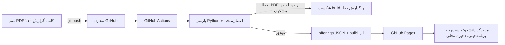

# SRS واحدچین — نسخه ۰.۶ (نسخه سبک)

تاریخ: ۲۴ مهر ۱۴۰۵. وضعیت: پیش‌نویس برای تأیید.

> **چرا نسخه سبک:** استاد فقط محصول کارا را ارزیابی می‌کند (تصمیم دانشجو، ۲۵ مهر). این سند فقط برای ثبت نیازمندی‌ها و ردیابی آن‌ها در کد و تست نگه داشته می‌شود و در مخزن GitHub کنار کد قرار می‌گیرد. جزئیات تحلیل PDF و رقبا در نسخه ۰.۳ و research brief باقی است.

## تاریخچه تغییرات

| نسخه | تغییر |
|---|---|
| ۰.۱ تا ۰.۳ | پیش‌نویس‌های قبلی (اپ آفلاین با ورود داده توسط خود کاربر) |
| ۰.۴ | **تغییر مدل داده:** داده ارائه دروس را تیم واحدچین تهیه و منتشر می‌کند، نه کاربر. PDF کامل گزارش ۱۱۰ در مخزن GitHub بارگذاری می‌شود، GitHub Actions آن را با پارسر Python به JSON تبدیل و اعتبارسنجی می‌کند، و سایت روی GitHub Pages به‌روز می‌شود. ورود PDF/CSV توسط کاربر، صفحه بازبینی و راهنمای چاپ از اپ حذف شدند. ورود و ویرایش دستی درس به C رفت. مستندات رسمی (UML و غیره) از برنامه کار حذف شد. |
| ۰.۵ | فرضیه A9 تأیید شد: صفحه آزمایشی `kh-27.github.io/vahedchin` از اینترنت داخل ایران بدون VPN باز شد (گزارش دانشجو). مخزن `kh-27/vahedchin` (عمومی) تعیین شد. |
| ۰.۶ | یافته‌های پارسر نهایی روی `all4051.pdf` (شاهد): (۱) هر صفحه گزارش گلستان در چاپ از یک برگ A3 بلندتر است و ۵۸ سطر بین دو صفحه PDF بریده شده‌اند؛ پروتوتایپ تکه دوم را دور می‌ریخت. اعداد NFR-13 اصلاح شد (۶۸۸۴ جلسه، ۳۶۵۸ امتحان) و FR-73 اضافه شد. (۲) «امتحان عملی» به‌عنوان امتحان دوم گروه (A7 اصلاح شد). (۳) جلسه «نیمه1 ت / نیمه2 ت» (فرضیه A10، FR-10). (۴) واحد اعشاری با «/» (مثل `0/5`، FR-61). (۵) یک گروه آموزشی می‌تواند در PDF دو دنباله صفحه داشته باشد. (۶) جلسه «هفتهN» فقط در یک هفته ترم (فرضیه A11، از `all405-1.pdf`). منبع داده منتشرشده: `data/raw/all405-1.pdf` (چاپ کامل ترم 4051، گزارش ۲۴ مهر ۱۴۰۵ ساعت ۱۷:۱۹، از دانشجو). `all4051.pdf` (ترم 4042) و چاپ‌های بریده فقط fixture تست‌اند و به `pipeline/tests/fixtures/` منتقل شدند. |

## ۱. محصول در یک نگاه

- **کاربر:** دانشجوی دانشگاه سمنان. لینک سایت را باز می‌کند، دانشکده و گروه آموزشی (رشته) را انتخاب می‌کند، دروس ارائه‌شده را می‌بیند و برنامه بدون تداخل می‌چیند.
- **تیم واحدچین (نگهدارنده):** هر بار که ارائه دروس در گلستان تغییر کرد، PDF کامل گزارش ۱۱۰ را در مخزن آپلود می‌کند. بقیه کار خودکار است.
- **پلتفرم:** وب‌اپ تک‌صفحه‌ای روی GitHub Pages، قابل نصب به‌صورت PWA. بدون سرور برنامه، دیتابیس مرکزی و حساب کاربری. برنامه‌های هر دانشجو فقط در مرورگر خودش ذخیره می‌شود.
- **فناوری:** اپ: TypeScript (strict)، React، Vite، IndexedDB، Web Worker، Vitest، Playwright. پایپ‌لاین داده: Python 3 + pdfplumber، pytest، GitHub Actions.

## ۲. محدوده

**در محدوده نسخه ۱.۰:**

- پایپ‌لاین خودکار PDF ← JSON ← سایت، با رد کردن داده نامعتبر.
- انتخاب دانشکده و گروه آموزشی، و جست‌وجو در همه دروس (برای دروس عمومی دانشکده‌های دیگر).
- تشخیص تداخل کلاس (با فرد/زوج) و امتحان.
- تولید خودکار و رتبه‌بندی ترکیب‌ها، و برنامه‌چینی دستی.
- جدول هفتگی، برنامه امتحانات شمسی، خروجی تصویر.
- نصب PWA و کار آفلاین پس از اولین بازدید.

**خارج از محدوده:** دانشگاه‌های دیگر (ساختار داده آماده است ولی داده فقط سمنان)، ورود PDF توسط کاربر، حساب کاربری و همگام‌سازی، پیش‌نیاز و چارت، اپ بومی، ثبت واحد.

## ۳. فرضیات (تأییدشده یا تصمیم دانشجو)

- **A1:** داده فقط از PDF چاپ کامل (A3 افقی) گزارش ۱۱۰ گلستان دانشگاه سمنان تهیه می‌شود. مسئولیت به‌روز بودن با تیم است.
- **A2:** کلاس‌ها شنبه تا پنجشنبه‌اند. کلاس جمعه در داده دیده نشد، ولی مدل داده آن را رد نمی‌کند.
- **A5:** «ف» = هفته فرد، «ز» = هفته زوج، بدون حرف = هر هفته. فرد با زوج تداخل ندارد.
- **A6:** کف واحد ۱۲. سقف: عادی ۲۰، معدل ترم قبل ≥ ۱۷ («الف») ۲۴، معدل ترم قبل < ۱۲ («مشروط») ۱۶. کاربر می‌تواند دستی عوض کند.
- **A7:** هر امتحان در داده گلستان ساعت شروع و پایان دارد. هر گروه حداکثر یک «امتحان» (کتبی) و یک «امتحان عملی» دارد (در `all4051.pdf`: یک گروه، `2020133_90`، امتحان عملی دارد).
- **A10 (فرضیه، باید تأیید شود):** «نیمه1 ت» و «نیمه2 ت» بعد از ساعت جلسه یعنی «نیمه اول/دوم ترم»؛ جلسه نیمه اول با جلسه نیمه دوم تداخل ندارد. شاهد: ۴ جلسه در ۲ گروه (`1118876_01`، `2722030_01`) که هر کدام یک جلسه نیمه1 و یک جلسه نیمه2 دارند؛ در `all405-1.pdf`، ۸ جلسه.
- **A11 (برداشت، باید تأیید شود):** «هفتهN» بعد از ساعت جلسه (مثل `درس(ت): شنبه 19:00-17:00 هفته14`) یعنی آن جلسه فقط در هفته N ترم برگزار می‌شود؛ پس فقط با جلسه‌های همان هفته (هر هفته، یا فرد/زوج هم‌زوجیت با N) تداخل دارد. شاهد: `all405-1.pdf`، گروه‌های `6060086_02` و `_03` («ایمنی تخصصی»، ۰ واحد): هر کدام ۳ جلسه ۲ ساعته در هفته‌های ۱۴ تا ۱۶ یا ۱۱ تا ۱۳، و توضیحات گروه می‌گوید «مدت زمان دوره 6 ساعت».
- **A9 (تأییدشده، ۲۴ مهر ۱۴۰۵):** `*.github.io` از اینترنت داخل ایران بدون VPN باز می‌شود. شاهد: گزارش دانشجو از باز شدن صفحه آزمایشی `https://kh-27.github.io/vahedchin/` (کد در `probe/`). اپراتورهای آزموده‌شده ثبت نشده‌اند. اگر در آینده فیلتر شد، فقط مقصد انتشار عوض می‌شود (مثلاً سرور مجازی خود تیم) و بقیه معماری ثابت می‌ماند.

## ۴. نیازمندی‌های عملکردی

اولویت: **M** ضروری، **S** مهم، **C** در صورت فرصت.

### ۴.۱ پایپ‌لاین داده (ابزار تیم)

| کد | نیازمندی | اولویت |
|---|---|---|
| FR-60 | با push یک PDF جدید در پوشه `data/raw/`، GitHub Actions پارسر را اجرا کند و خروجی JSON ترم را تولید کند | M |
| FR-61 | پارسر متن را نرمال کند: ترتیب دیداری به منطقی، حروف نمایشی به پایه (اول برعکس، بعد NFKC)، «ي/ك/ھ» به «ی/ک/ه»، ارقام عربی و فارسی به لاتین؛ عدد اعشاری گلستان با «/» نوشته می‌شود (`0/5` = ۰٫۵) | M |
| FR-62 | هر مقدار نامعتبر (ساعت یک‌رقمی، پایان ≤ شروع، روز ناشناخته، ورودی ناشناخته در ستون زمان، ستون عددی غیرعددی) build را شکست دهد و سطر خام را در گزارش خطا نشان دهد. داده مشکوک هرگز منتشر نشود | M |
| FR-63 | خلاصه هر اجرا در گزارش Actions نوشته شود: تعداد دانشکده، گروه آموزشی، درس، گروه، جلسه، امتحان، فرد/زوج، و تعداد خطاها | M |
| FR-65 | جلسه تک‌تاریخی (تاریخ به‌جای روز) با نوع جدا ذخیره شود و در تداخل هفتگی شرکت نکند، ولی در جزئیات گروه نمایش داده شود | S |
| FR-66 | گزارش تغییرات نسبت به نسخه قبلی همان ترم (گروه اضافه‌شده، حذف‌شده، تغییر ساعت یا امتحان) در خلاصه Actions | C |
| FR-68 | PDF چاپ بریده رد شود: اگر جدول ۱۳ ستون (شامل «توضیحات» و «حذف اضطراری») نداشته باشد، build شکست بخورد | M |
| FR-69 | ترم از سربرگ PDF تشخیص داده شود (مثلاً «نیمسال دوم ۰۵-۰۴» ← `4042`) و فایل خروجی `data/terms/<term>.json` نام بگیرد | M |
| FR-73 | سطری که در انتهای صفحه PDF بریده شده و در صفحه بعد (صفحه ادامه، بدون سربرگ) ادامه دارد، به همان سطر وصل شود. تکه‌ای که سطر قبلی ندارد، سطر بدون کد، صفحه‌های ناقص یک گروه آموزشی («صفحه x از y») یا کد گروه تکراری build را شکست دهد | M |

### ۴.۲ داده در اپ

| کد | نیازمندی | اولویت |
|---|---|---|
| FR-70 | اپ ترم جاری و تاریخ آخرین به‌روزرسانی داده را نمایش دهد («داده گلستان: ۲۴ مهر ۱۴۰۵، ساعت ۱۲:۴۶») | M |
| FR-71 | اگر داده جدید منتشر شد و گروهی در برنامه ذخیره‌شده کاربر حذف یا تغییر کرده بود، به کاربر هشدار داده شود | S |
| FR-72 | اگر چند ترم در داده باشد، کاربر بتواند ترم را انتخاب کند (پیش‌فرض: جدیدترین) | C |
| FR-01 | کاربر بتواند یک درس یا گروه دستی به سناریوی خودش اضافه کند (برای موارد خارج از PDF) | C |

### ۴.۳ مرور و جست‌وجوی دروس

| کد | نیازمندی | اولویت |
|---|---|---|
| FR-47 | انتخاب دانشکده و گروه آموزشی (رشته) و مقطع؛ فهرست دروس همان گروه، با گروه‌های هر درس | M |
| FR-48 | جست‌وجو در همه دروس دانشگاه بر اساس نام، کد و استاد (برای دروس عمومی و دروس دانشکده‌های دیگر) | M |
| FR-49 | جزئیات هر گروه: استاد، جلسه‌ها (نوع، روز، ساعت، فرد/زوج، مکان)، امتحان، ظرفیت/ثبت‌نامی، جنسیت، توضیحات، امکان اخذ توسط سایر مراکز، حذف اضطراری | M |
| FR-26 | فیلتر جنسیت: با تنظیم جنسیت کاربر، گروه‌های ناسازگار پنهان یا غیرقابل انتخاب شوند. «مختلط» همیشه مجاز | S |
| FR-27 | نشان «ظرفیت پر» برای ثبت‌نامی ≥ ظرفیت، با یادآوری زمان تهیه داده | C |

### ۴.۴ تداخل

| کد | نیازمندی | اولویت |
|---|---|---|
| FR-10 | تداخل جلسه: روز یکسان + نوع هفته سازگار (جلسه «هفتهN» فقط با هفته N، A11) + نیمه ترم سازگار (A10؛ بدون نیمه با هر دو نیمه سازگار است) + هم‌پوشانی باز (s1 < e2 و s2 < e1). پایان یکی = شروع دیگری تداخل نیست | M |
| FR-11 | تداخل امتحان: تاریخ یکسان + هم‌پوشانی بازه | M |
| FR-12 | هشدار نرم «دو امتحان در یک روز» و «فاصله کمتر از N روز» (N قابل تنظیم، پیش‌فرض غیرفعال) | M |
| FR-13 | گزارش هر تداخل با هر دو طرف (درس، گروه، زمان) | M |

### ۴.۵ سناریو، قیدها و ترکیب‌ها

| کد | نیازمندی | اولویت |
|---|---|---|
| FR-20 | ساخت یک یا چند سناریو و افزودن دروس به آن | M |
| FR-21 | درس ضروری یا اختیاری | M |
| FR-22 | کنار گذاشتن یا قفل کردن گروه | M |
| FR-23 | کف و سقف واحد از وضعیت آموزشی (عادی/الف/مشروط) یا معدل ترم قبل (A6)، با امکان تغییر دستی | M |
| FR-24 | بازه‌های مسدود (مثلاً سه‌شنبه عصر) | S |
| FR-25 | ترجیحات وزن‌دار: روزهای کمتر، بدون کلاس قبل از ساعت X، فاصله خالی کمتر، استاد ترجیحی، فاصله بیشتر بین امتحان‌ها | M |
| FR-30 | تولید همه ترکیب‌های معتبر (عقب‌گرد با هرس) | M |
| FR-31 | امتیاز و مرتب‌سازی، با نمایش سهم هر ترجیح | M |
| FR-32 | سقف نتایج (پیش‌فرض ۵۰۰) و اعلام پر شدن آن | M |
| FR-33 | توضیح علت نبود ترکیب معتبر | S |
| FR-34 | محاسبه در Web Worker، قابل لغو | S |

### ۴.۶ نمایش، ذخیره و خروجی

| کد | نیازمندی | اولویت |
|---|---|---|
| FR-40 | جدول هفتگی با ساعت پیوسته، رنگ هر درس و نشانه فرد/زوج | M |
| FR-41 | برنامه امتحانات به ترتیب تاریخ شمسی با نام روز، خوانا روی ۳۶۰px | M |
| FR-42 | برنامه‌چینی دستی با هشدار زنده | M |
| FR-44 | ذخیره برنامه نهایی سناریو در مرورگر (IndexedDB) | M |
| FR-45 | خروجی تصویر PNG از جدول هفتگی و امتحانات | S |
| FR-07 | خروجی و ورود JSON سناریوها (انتقال بین دستگاه‌ها) | S |
| FR-46 | خروجی تقویم ics | C |
| FR-50 | اعداد فارسی در نمایش؛ پذیرش ورودی فارسی و انگلیسی | M |
| FR-51 | اجرا در مرورگر بدون نصب و قابل نصب به‌صورت PWA | M |
| FR-53 | کار آفلاین پس از اولین بازدید: مرور دروس و برنامه‌چینی بدون اینترنت؛ فقط دریافت داده جدید اینترنت می‌خواهد | S |

## ۵. نیازمندی‌های غیرعملکردی

| کد | نیازمندی | سنجش |
|---|---|---|
| NFR-01 | تولید ترکیب برای ۱۰ درس × ۵ گروه کمتر از ۲ ثانیه | تست کارایی Vitest |
| NFR-02 | هشدار تداخل در حالت دستی کمتر از ۱۰۰ میلی‌ثانیه | تست خودکار |
| NFR-03 | نتیجه الگوریتم روی ورودی‌های کوچک برابر brute-force | تست property-based |
| NFR-04 | هیچ داده کاربر به شبکه ارسال نشود | Playwright با رهگیری شبکه |
| NFR-08 | مرورگرهای Chrome، Edge، Firefox (دو نسخه آخر) و Chrome اندروید؛ عرض ≥ ۳۶۰px | تست دستی |
| NFR-10 | پوشش تست هسته (تداخل، ترکیب، امتیاز) و پارسر ≥ ۹۰٪ | گزارش Vitest و pytest-cov |
| NFR-12 | اجرای پایپ‌لاین روی GitHub Actions کمتر از ۱۰ دقیقه (پارسر نهایی، محلی با ۳۲ هسته: ۲۰ ثانیه؛ پروتوتایپ: ۳ دقیقه و ۴۶ ثانیه) | زمان اجرای Actions |
| NFR-13 | روی فایل مرجع `pipeline/tests/fixtures/all4051.pdf`: ۵۲۹۷ گروه، ۶۸۸۴ جلسه (۱۸ تک‌تاریخی، ۴ نیم‌ترم)، ۳۶۵۸ امتحان و ۱ امتحان عملی، ۱۳۰ فرد و ۱۴۶ زوج، ۵۸ سطر بریده‌ی وصل‌شده، صفر خطا. اعداد قبلی (۶۸۸۱ جلسه، ۳۶۰۸ امتحان) خروجی پروتوتایپ بودند که تکه سطرهای بریده را دور می‌ریخت؛ با حذف همان تکه‌ها پارسر نهایی دقیقاً همان اعداد را می‌دهد. روی `pipeline/tests/fixtures/all4042-clipped.pdf` و `all405-clipped.pdf` (بریده): رد شود. نمونه ۵۰ گروه تصادفی با PDF برابر باشد. (اطلاع، نه معیار: منبع فعلی `data/raw/all405-1.pdf`، ترم 4051: ۴۹۱۴ گروه برابر با چاپ بریده همان ترم، ۶۷۵۶ جلسه، ۳۳۷۳ امتحان، ۴۴ سطر بریده، صفر خطا) | pytest + بازبینی دستی |
| NFR-14 | معیارهای نصب PWA (manifest، آیکون، Service Worker) | Lighthouse |
| NFR-15 | اولین باز شدن روی 4G کمتر از ۵ ثانیه. داده ترم 4042 (`data/terms/4042.json`): ۳٫۲ مگابایت خام و ۲۰۱ کیلوبایت gzip (اندازه‌گیری روی خروجی واقعی) | Lighthouse |
| NFR-16 | هر به‌روزرسانی داده یک commit با پیام استاندارد (`data: <term> <تاریخ گزارش>`) باشد تا تاریخچه قابل پیگیری بماند | بازبینی تاریخچه git |

## ۶. User Storyهای اصلی و معیار پذیرش

**US-11 — به‌روزرسانی داده توسط تیم (FR-60 تا FR-69)**

- با push فایل `all4051.pdf`، Actions فایل `data/terms/4042.json` را می‌سازد، خلاصه با اعداد NFR-13 را گزارش می‌کند و سایت به‌روز می‌شود.
- با push یک چاپ بریده (مثل `all4042-clipped.pdf`)، build با پیام «PDF بریده است؛ با A3 افقی دوباره چاپ کنید» شکست می‌خورد و سایت قبلی دست‌نخورده می‌ماند.

**US-14 — پیدا کردن دروس رشته (FR-47 تا FR-49)**

- کاربر «مهندسی مواد و متالورژی» ← «مهندسی مواد» ← «کارشناسی» را انتخاب می‌کند و «ریاضی مهندسی» را با گروه `1118061_01` می‌بیند: شنبه ۱۰:۳۰–۱۲:۳۰، دوشنبه ۱۷:۰۰–۱۸:۰۰، حل تمرین دوشنبه ۱۸:۰۰–۱۹:۰۰، امتحان ۱۴۰۵/۰۴/۰۶ ساعت ۱۶:۰۰–۱۸:۰۰.
- جست‌وجوی «شیمی عمومی» گروه `1118424_01` را با جلسه «دوشنبه ۱۰:۳۰–۱۲:۳۰، هفته فرد» نشان می‌دهد.

**US-03 — تداخل کلاس:** شنبه ۱۰–۱۲ با شنبه ۱۱–۱۳ تداخل دارد؛ با شنبه ۱۲–۱۴ ندارد؛ فرد با زوج هم‌زمان تداخل ندارد؛ هر هفته با فرد تداخل دارد.

**US-04 — تداخل امتحان:** دو امتحان ۱۴۰۵/۰۴/۲۷، یکی ۰۸:۰۰–۱۰:۰۰ و دیگری ۰۹:۰۰–۱۱:۰۰، تداخل سخت دارند؛ ۰۸:۰۰–۱۰:۰۰ و ۱۰:۰۰–۱۲:۰۰ فقط هشدار «دو امتحان در یک روز» می‌گیرند.

**US-05 — تولید ترکیب:** ۴ درس × ۳ گروه که فقط ۵ ترکیب از ۸۱ ترکیب معتبر دارند، دقیقاً همان ۵ را نشان می‌دهد؛ ۱۰ درس × ۵ گروه کمتر از ۲ ثانیه.

**US-06 — رتبه‌بندی:** با بیشترین وزن روی «روزهای کمتر»، ترکیب ۳‌روزه بالاتر از ۴‌روزه می‌آید.

**US-13 — سقف واحد:** معدل ۱۷.۵۰ ← سقف ۲۴؛ معدل ۱۱.۹۹ ← سقف ۱۶؛ معدل ۱۵ ← ۲۰؛ معدل دقیقاً ۱۷ ← ۲۴؛ دقیقاً ۱۲ ← ۲۰؛ ترکیب ۱۱ واحدی نامعتبر (کف ۱۲)؛ مقدار دستی کاربر مقدم است.

**US-07 — برنامه‌چینی دستی:** انتخاب گروه متداخل خانه‌ها را قرمز می‌کند و پیام کمتر از ۱۰۰ میلی‌ثانیه می‌آید.

**US-10 — دسترسی:** لینک در Chrome اندروید بدون نصب کار می‌کند؛ با «افزودن به صفحه اصلی» مثل اپ باز می‌شود؛ (S) بعد از اولین بازدید بدون اینترنت هم دروس و برنامه‌ها دیده می‌شوند.

## ۷. قواعد کسب‌وکار

- **BR-1:** از هر درس در ترکیب دقیقاً یک گروه.
- **BR-2:** تداخل جلسه طبق FR-10. **BR-3:** تداخل امتحان طبق FR-11.
- **BR-4:** کف ≤ مجموع واحد ≤ سقف (A6).
- **BR-5:** دروس ضروری همیشه در ترکیب‌اند. **BR-6:** قفل همیشه انتخاب، کنارگذاشته هرگز.
- **BR-8:** فیلتر جنسیت طبق FR-26.
- **BR-9:** داده نامعتبر یا PDF بریده هرگز منتشر نمی‌شود (FR-62، FR-68).

## ۸. ریسک‌ها

| ریسک | راهکار |
|---|---|
| `github.io` از داخل ایران فیلتر شود (A9، فعلاً باز است) | تست اولیه موفق بود؛ جایگزین: انتشار همان فایل‌های ثابت روی سرور مجازی تیم |
| تیم PDF بریده یا قدیمی آپلود کند | FR-68 و FR-62 در CI؛ نمایش تاریخ داده در اپ (FR-70) |
| تغییر قالب گزارش گلستان | تست مرجع در CI؛ شکست صریح build به‌جای داده غلط |
| انفجار ترکیبیاتی | هرس، سقف نتایج، Web Worker |
| پاک شدن داده مرورگر کاربر | خروجی JSON (FR-07) و `navigator.storage.persist` |

## ۹. موارد باز

1. نام نهایی محصول.

بسته‌شده در ۰.۵: نتیجه تست A9 (باز شد)؛ مخزن `kh-27/vahedchin` و پوشه محلی `C:\Projects\Boostan`.
